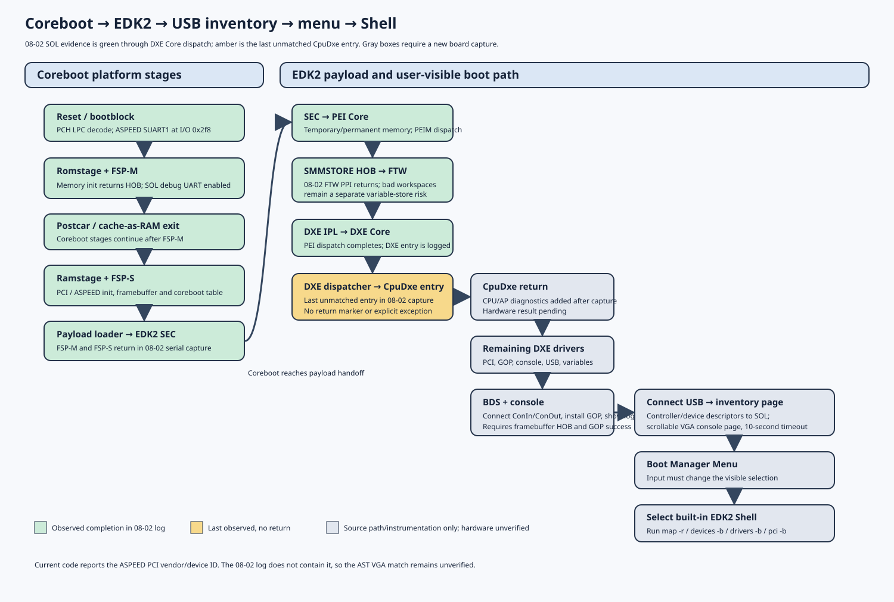

# Boot flow, SOL, graphics, USB, menu, and Shell

## Evidence labels

- **Observed:** present in `/home/uefi/workspace/log/1405-08-02/serial.log`.
- **Source configured:** current integration sources enable and trace a path,
  but no new board capture confirms it.
- **Unverified:** requires the board to reach and interact with that stage.

The current capture reports successful FSP-M and FSP-S, EDK2 SEC and PEI
progress, PEI dispatcher completion, DXE IPL handoff, DXE Core initialization,
and several DXE driver returns. The final complete marker is `CpuDxe` entry;
there is no return marker, exception, or reset reason. Treat that as the last
observed point, not as proof of the failing instruction.



## Hardware and configuration baseline

The user reports 64 GiB RAM, four fans, BMC, and SOL. The factory image and
target ROM size are 64 MiB. The board target is a two-socket Archer City / G4DEL
configuration with the Archer City dual-socket IIO PCIe table as a provisional
starting point. Actual CPU models, active socket/processor count, and DIMM slot
count are not known from the logs. Do not raise the EDK2 processor limit or
alter AP-start behavior until a new `[GX-MP]` trace reports runtime counts.

`configs/config.gooxi_g4del` is the selected build interface. It pins the EDK2
source to pinned commit `ead1df0f527f48955d245a1f50072c6f22f6f007` and
the edk2-platforms input to `9ef9bcef5090effeb569f61c8585795fdb41d41d`. The
G4DEL Kconfig defaults to two sockets and a 64 MiB ROM. The defconfig selects a
linear framebuffer, SMMSTORE v2 at 256 KiB, the Shell, and debug builds. The
device tree and IIO routing remain provisional until tested on this board.

## Reset → coreboot → EDK2

1. **Reset and bootblock — source configured; prior SOL setup observed.**
   `src/mainboard/gooxi/g4del/bootblock.c` enables PCH LPC decode for COM1 and
   COM2, opens the ASPEED SuperIO config path, and configures SUART1 at the
   selected `CONFIG_TTYS0_BASE=0x2f8`. The G4DEL defconfig sets 115200 baud.
   This follows the previously working SOL path; confirm it with SOL from
   reset on the next capture.
2. **Romstage and FSP-M — observed success.**
   `src/mainboard/gooxi/g4del/romstage.c` enables the FSP-M debug UART at
   `0x2f8` and supplies the dual-socket IIO table. `src/soc/intel/xeon_sp/romstage.c`
   calls FSP memory initialization. The 08-02 trace reports FSP-M entry and
   return, status zero, and a HOB pointer.
3. **Postcar and ramstage / FSP-S — observed success.**
   Coreboot exits cache-as-RAM, configures silicon in ramstage through
   `src/soc/intel/xeon_sp/spr/chip.c`, enumerates devices, and prepares
   framebuffer/coreboot-table data. The serial capture records FSP-S return
   status zero and reaches the EDK2 payload loader.
4. **FSP-T — present, runtime call not observed.** The current build splits
   and packages FSP-T/M/S. The capture demonstrates FSP-M and FSP-S calls.
   It does not demonstrate `FspTempRamInit`; coreboot supplies its own
   bootblock/cache-as-RAM flow. Do not describe FSP-T as a completed runtime
   call without a source/capture marker.
5. **Payload handoff and SEC — observed.** Coreboot loads EDK2 from CBFS and
   hands off using its payload loader. EDK2 SEC locates the PEI entry and
   serial tracing continues.

`src/mainboard/gooxi/g4del/ramstage.c` prints the effective board/socket/ROM/
UART/FSP/SMMSTORE/graphics settings, FMAP ranges, and each enumerated ASPEED
PCI function's vendor, device, class, enabled state, and initialization state.
This new runtime ID log is what should be used to check the ASPEED VGA driver's
PCI match. The 08-02 capture predates it and does not show the actual G4DEL
VGA function ID. The current driver table matches ASPEED vendor `0x1a03`, VGA
device `0x2000` (`PCI_DID_ASPEED_AST2050_VGA`); **do not change that match until
the device ID is captured from this board**. The AST common code contains
AST2600 paths, but a driver name or a family manual is not a substitute for
the PCI ID.

FSP binaries are taken from `3rdparty/fsp/EagleStreamFspBinPkg/Fsp.fd` and
split by `3rdparty/fsp/Tools/SplitFspBin.py`. The stock image also contains
FSP-S/M/T-looking firmware volumes; those factory bytes are inspection data,
not build inputs. Record the exact FSP input hash, split-component hashes,
header IDs, and revisions for each build. FSP-M/S status zero in the old log
is evidence for those two calls only.

## EDK2 SEC, PEI, DXE, and BDS

```mermaid
flowchart LR
  CB[Coreboot payload handoff] --> SEC[EDK2 SEC]
  SEC --> PEI[PEI Core and PEIM dispatcher]
  PEI --> HOB[SMMSTORE / platform / graphics HOBs]
  HOB --> FTW[FaultTolerantWrite PEIM]
  FTW --> IPL[DXE IPL]
  IPL --> DXE[DXE Core and dispatcher]
  DXE --> CPU[CpuDxe]
  CPU --> REM[Remaining DXE drivers]
  REM --> BDS[BDS and consoles]
  BDS --> USB[USB inventory page]
  USB --> MENU[Boot Manager Menu]
  MENU --> SHELL[Shell selected by user]
```



The 08-02 trace verifies the path through the DXE dispatcher and starts
`CpuDxe` GUID `1A1E4886-9517-440E-9FDE-3BE44CEE2136`; its completion and every
later node in the diagram are unverified. `CpuDxe.c`, `CpuMp.c`, and
`MpLib.c` now emit begin/return and AP-count checkpoints. Preserve that
information in the next log; do not bypass a failing CPU initialization.

Two earlier findings need separate tracking:

- FTW reports both workspace copies invalid but installs its completion PPI
  and returns. That can affect nonvolatile variables/boot options after the
  current DXE stop is fixed; it did not stop the observed PEI dispatch.
- `BlSupportPei` installs PEI memory but reports platform information `Not
  Found` and returns that status; PEI dispatch continues. Identify the missing
  optional platform source separately instead of suppressing the error.

### Menu and Shell selection

In G4DEL diagnostic builds, `PlatformBootManagerBeforeConsole()` registers the
Boot Manager Menu option even when the boot-menu variable is absent. After
console setup, `PlatformBootManagerAfterConsole()` connects devices, displays
the logo if GOP is ready, and then shows the USB inventory page. The
`GOOXI_G4DEL_USB_DIAGNOSTICS` build define makes BDS enter the existing
BootManagerMenuApp path after the inventory page. It does not replace the menu
or launch Shell automatically. The normal menu should expose the built-in
Shell option. Require a visible menu selection change and a successful Shell
command on the board.

The EDK2 FDF/DSC already includes `BootManagerMenuApp`, Shell, GOP/console,
xHCI, USB bus, USB keyboard, USB mouse, and USB mass-storage modules. Inclusion
does not by itself prove the dispatcher loaded each driver or that hardware
enumeration succeeded; preserve each dispatcher entry/return and USB status.

## SOL and serial diagnostic route

The coreboot → EDK2 serial chain is:

```text
G4DEL board Kconfig: TTYS0 base 0x2f8, baud 115200
  -> PCH LPC I/O decode and ASPEED SUART1 at 0x2f8 (bootblock)
  -> coreboot console / FSP-M debug UART
  -> EDK2 build: -D SOL_UART_BASE=0x2f8 and PcdSerialRegisterBase=0x2f8
  -> SEC serial library, DXE Core serial port, PCD-based EDK2 serial drivers
  -> SOL transcript from reset through BDS and Shell
```

Coreboot's `payloads/external/edk2/Makefile` derives the UART base from
`CONFIG_TTYS0_BASE`, enables serial terminal support, and sets the serial
register PCD. The current build also enables serial redirection and debug
error logs. A console UART and SOL are not equivalent to an attached keyboard:
input must also be connected through EDK2 ConIn or the BMC/USB keyboard route.

Expected next markers, in order, include:

```text
[GX-FMAP] ...
[GX-GFX] ASPEED PCI function vendor=... device=... class=...
[GX-FSP] ... (only if the source path calls that FSP phase)
[GX-CPU] ... / [GX-MP] ...
[EDK2-DIAG] CHECKPOINT DXE driver returned 1A1E4886-9517-440E-9FDE-3BE44CEE2136
[GX-GOP] ... / [GX-LOGO] ...
[GX-USB] connect all begin / connect all returned
[GX-USB] host-controller enumeration status=... / device-interface enumeration status=...
[GX-USB] interface[n] ... vid=... pid=... interface=... path=...
[GX-USB] VGA inventory page begin ... / VGA inventory page return ...
[GX-BDS] Boot Manager Menu launch begin ...
[GX-MENU] entry ...
[GX-SHELL] entry ...
```

The marker spelling may be source-version-specific. Keep the raw SOL file,
including an incomplete last line; record ROM readback SHA-256, BMC power/POST
and SEL evidence, and VGA photos/video. Compare both begin/return pairs and
the last checkpoint rather than interpreting a black screen alone.

## Coreboot and EDK2 graphics path

The factory manual describes a Gooxi SL201-G4 family, not every G4DEL revision.
The 08-02 log does not show the ASPEED PCI ID. Coreboot now logs each discovered
ASPEED function and the driver's matched ID; use those values to decide if the
existing `0x1a03:0x2000` driver declaration is correct. No driver ID change is
made on speculation.

Current G4DEL defconfig selects `GENERIC_LINEAR_FRAMEBUFFER` and the ASPEED
native display path. Coreboot selects an EDID mode or its logged fallback,
registers the framebuffer, and publishes `LB_TAG_FRAMEBUFFER`. At CBMEM-ready,
coreboot loads `BOOTSPLASH/logo.bmp`, stores it with a size header in CBMEM,
and exports a coreboot-table logo tag. EDK2's `CbParseLib` validates the
framebuffer record and `BlSupportPei` publishes a graphics-info HOB;
`GraphicsOutputDxe` installs GOP from that HOB. `LogoDxe` decodes the CBMEM
bitmap to GOP BLT and BDS calls `BootLogoEnableLogo()` after console setup.

The configured generic logo is `Documentation/coreboot_logo.bmp`, not vendor
artwork. Its CBFS copy in the 1 MiB `BOOTSPLASH` region is a build check only;
visible pixels require the coreboot framebuffer, EDK2 HOB, GOP, and console to
all succeed.

Coreboot's legacy text breadcrumbs write the VGA text aperture at `0xB8000`
only in VGA text mode. The current linear framebuffer configuration disables
those direct text-memory writes; SOL is the early reliable log. The new USB
inventory uses EDK2 `Print()` on `gST->ConOut`; it appears on the VGA output
only if GraphicsConsole/ConOut is successfully connected. SOL inventory is
written using `DEBUG()` and also depends on the configured serial debug path.
Neither serial text nor a coreboot `0xB8000` breadcrumb proves that EDK2 GOP or
the menu has initialized.

## USB discovery and display behavior

G4DEL builds the `G4delUsbDiagnostics.c` helper into
`PlatformBootManagerLib`. In `PlatformBootManagerAfterConsole()`, it:

1. calls `EfiBootManagerConnectAll()` so xHCI/EHCI/UHCI controllers, USB bus,
   keyboard, mouse, and mass-storage drivers can bind;
2. stalls for a bounded one second to allow enumeration to settle;
3. logs each `EFI_USB2_HC_PROTOCOL` host controller's capability and state;
4. enumerates `EFI_USB_IO_PROTOCOL` handles and logs device/config/interface
   descriptor status, VID/PID, class/subclass/protocol, interface number,
   available manufacturer/product/serial strings, and device path;
5. draws a scrollable text inventory using `gST->ConOut` for ten seconds.

Use Up/Down or Page Up/Page Down to scroll; Enter or Esc continues. Timer
expiry continues automatically. The EDK2 USB I/O protocol does not expose a
per-device negotiated link speed, so the log reports that limitation and logs
only the host controller's maximum speed. Partial descriptor failures are
reported with status values; a missing string must not hide VID/PID or the
device path. USB keyboard and storage operation remain unverified until a
fresh board capture and interaction test.

UEFI Shell is not a Linux environment and does not include `lsusb`. After
launching Shell, use `devices -b`, `drivers -b`, `pci -b`, and `map -r`; with a
USB storage device inserted, verify a filesystem mapping and read a small
file. The USB page is a pre-menu inventory; it does not replace those Shell
checks.

## Rebuilt flash layout

The FMD declares 64 MiB total. The IFD map preserves all four factory non-BIOS
regions. Inside the BIOS region, it reserves 256 KiB SMMSTORE, 1 MiB BOOTSPLASH,
0x800 bytes FMAP metadata, and the remaining `COREBOOT` CBFS/stage area. The
current expected offsets and the factory map are in
[`factory_image_inventory.md`](factory_image_inventory.md) and
[`flash-map.svg`](images/flash-map.svg). `SI_PT` is renamed to the canonical
`SI_DEVICEEXT` FMAP name. The verification utility checks bounds, exact region
coverage, no overlaps or gaps, and SMMSTORE size/alignment.

The extracted descriptor, ME, GbE, and Device Exp1 blobs are local build inputs
under ignored `deps/blobs`; compare them byte-for-byte with the four factory
ranges before accepting the ROM. Do not copy factory BIOS bytes or vendor
variable values into the replacement BIOS.

## Next boot and acceptance criteria

Record the flashed image SHA-256 and chip readback SHA-256, then capture from
reset. Also capture BMC power state, POST/power-fault code, SEL, SOL, VGA, and
USB devices physically attached during the test. Do not label a static build
as a successful boot.

Required order:

1. `CpuDxe` begin/return pair, then complete DXE dispatcher.
2. BDS console connection, framebuffer HOB, GOP install, and visible splash.
3. USB host-controller and per-device serial inventory plus the VGA inventory
   page. Test Up/Down, Page keys, Enter/Esc, and automatic timeout.
4. Visible Boot Manager Menu; attached input changes the highlighted entry.
5. Select Shell, run a command, inspect device/driver/PCI lists, and verify a
   USB storage map if storage is attached.

If the trace stops later, resolve the operation between its last paired
entry/return markers. A board test passes only when the menu and Shell are
interactive and a Shell command returns output.
